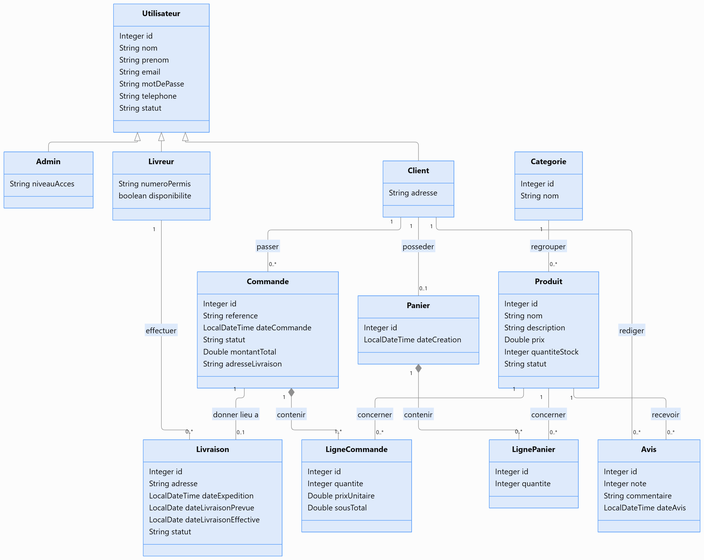

# MBOA Electronic Shop

Application e-commerce de vente de produits électroniques : catalogue par catégories, panier, commandes, livraison et avis clients.

## Un projet fil rouge

MBOA Electronic Shop est le **projet fil rouge** d'une formation en programmation web backend avec **Spring Boot**. Je le construis **pas à pas avec les apprenants** : à chaque séance, nous ajoutons une nouvelle notion du cours (entités JPA, repositories, services, contrôleurs REST, DTO, validation…) et le dépôt est mis à jour au fur et à mesure.

L'historique des commits suit donc la progression de la formation. Le projet n'est pas terminé : il évolue à chaque séance.

## Conception

Le diagramme de classes sert de référence pour tout le projet :



Entités prévues : `Utilisateur` (et ses rôles `Admin`, `Client`, `Livreur`), `Categorie`, `Produit`, `Panier`, `LignePanier`, `Commande`, `LigneCommande`, `Livraison` et `Avis`.

## Avancement

**Backend**

- [x] Initialisation du projet Spring Boot et connexion à MySQL
- [x] Entités `Produit`, `Categorie`, `Panier`, `LignePanier`, `LigneCommande`, `Avis`
- [ ] Entités `Utilisateur`, `Admin`, `Client`, `Livreur`, `Commande`, `Livraison`
- [x] Repository et service pour `Produit`
- [ ] Repositories et services des autres entités
- [ ] Contrôleurs REST
- [ ] DTO
- [ ] Validation des données et gestion des erreurs
- [ ] Sécurité (authentification et rôles)

**Frontend** : à venir.

## Technologies

- Java 17, Spring Boot, Spring Data JPA (Hibernate)
- MySQL (avec XAMPP)
- Maven

## Structure

```text
mboaElectronicShop/
├── backend/                          API Spring Boot
│   └── src/main/java/com/logonedigital/mboaElectronicShop/
│       ├── Entity/                   entités JPA
│       ├── Repository/               accès aux données
│       └── Service/                  logique métier (interfaces et implémentations)
├── docs/                             diagramme de classes
└── frontend/                         à venir
```

## Lancer le backend

**Prérequis** : JDK 17 ou plus récent, et XAMPP (ou un autre serveur MySQL).

1. Dans le **XAMPP Control Panel**, cliquez sur **Start** à côté de **MySQL**.
2. La première fois, créez une base vide nommée **`mboaelectronicshop`** (par exemple dans phpMyAdmin : http://localhost/phpmyadmin). Les tables sont créées automatiquement par Hibernate au démarrage.
3. Lancez le backend :
   - **Avec IntelliJ IDEA** : ouvrez le dossier `backend`, puis lancez la classe `MboaElectronicShopApplication` (bouton ▶).
   - **En ligne de commande** :

     ```bash
     cd backend
     ./mvnw spring-boot:run      # macOS / Linux / Git Bash
     mvnw.cmd spring-boot:run    # Windows (invite de commandes ou PowerShell)
     ```

L'API démarre sur http://localhost:8081.

La connexion à la base utilise la configuration par défaut de XAMPP (utilisateur `root`, sans mot de passe). Pour la modifier, voir `backend/src/main/resources/application.properties`.
